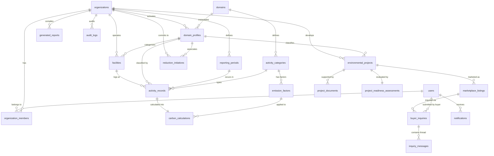
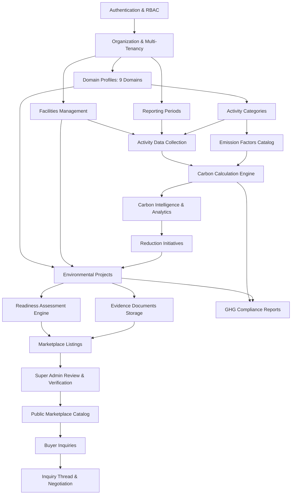

# EcoPulse MVP V3 — Master Architecture & Technical Specification

**Product Name:** EcoPulse  
**Platform Version:** MVP V3  
**Architecture Classification:** Enterprise Multi-Domain Carbon Intelligence & Carbon Marketing SaaS  
**Target Environment:** Windows / XAMPP (Apache, MySQL 8+, PHP 8.2+)  
**Frontend Stack:** HTML5, CSS3, Vanilla JavaScript (ES6+), Bootstrap 5, Bootstrap Icons, Chart.js, Fetch API  
**Backend Stack:** PHP 8.2+ (Strict Types, MVC-inspired, PDO, JSON REST APIs)  
**Date:** November 2026  

---

## 1. Complete Folder Architecture

The project maintains strict physical and logical separation between `Frontend` and `Backend` in `EcoPulse MVP v3`.

```text
EcoPulse MVP v3/
├── ARCHITECTURE.md                  # Master architecture & technical specification
├── README.md                        # Quick start & local development instructions
├── Backend/                         # Core API, business logic, calculation engine & storage
│   ├── .htaccess                    # URL rewrite routing to index.php
│   ├── index.php                    # Front controller & REST API router entry point
│   ├── config/                      # Configuration files
│   │   ├── app.php                  # Environment, debug, base URL, timezone
│   │   ├── database.php             # PDO connection parameters
│   │   ├── cors.php                 # Allowed origins, headers, credentials
│   │   └── constants.php            # Roles, scopes, domains, listing statuses
│   ├── core/                        # Framework & base infrastructure
│   │   ├── Database.php             # Singleton PDO database connector
│   │   ├── Router.php               # Lightweight RESTful HTTP router
│   │   ├── Request.php              # Sanitized request object (GET, POST, JSON, files)
│   │   ├── Response.php             # Standardized JSON response emitter (success/error)
│   │   ├── Session.php              # Secure session manager (HttpOnly, SameSite, rotation)
│   │   ├── Auth.php                 # Authentication & token/session validator
│   │   └── Logger.php               # Application, audit, and calculation log handler
│   ├── middleware/                  # HTTP interceptors
│   │   ├── CorsMiddleware.php       # CORS headers & preflight OPTIONS handler
│   │   ├── AuthMiddleware.php       # Ensures valid authenticated session
│   │   ├── RoleMiddleware.php       # Super admin vs buyer vs org role checks
│   │   ├── TenantMiddleware.php     # Enforces organization context and prevents cross-tenant leaks
│   │   └── RateLimiter.php          # In-memory / file-based login & request throttling
│   ├── controllers/                 # Endpoint logic controllers
│   │   ├── AuthController.php       # Register, login, logout, me, change-password
│   │   ├── OrganizationController.php# Org profile, domains, settings, statistics
│   │   ├── DomainController.php     # 9 business domains metadata, categories, configs
│   │   ├── FacilityController.php   # Facility CRUD & assignments
│   │   ├── ReportingPeriodController.php # Annual & quarterly period management
│   │   ├── ActivityDataController.php# Activity data ingestion, validation, batch entry
│   │   ├── EmissionFactorController.php# Factor catalog, scopes 1/2/3, sources, versioning
│   │   ├── CarbonCalculationController.php # Trigger calculations, store immutable audit trails
│   │   ├── AnalyticsController.php  # Aggregated emissions by scope, domain, period, facility
│   │   ├── ReductionInitiativeController.php # Decarbonization plans & target tracking
│   │   ├── EnvironmentalProjectController.php # Projects, stages, verification evidence
│   │   ├── ReadinessAssessmentController.php # Readiness checklist, score calculation, gap analysis
│   │   ├── MarketplaceController.php# Public marketplace & organization listings
│   │   ├── BuyerInquiryController.php# Inquiries from buyers, org replies, status changes
│   │   ├── ReportController.php     # GHG Protocol summary generation (PDF/JSON/CSV)
│   │   ├── TeamController.php       # Org members, invites, role assignments
│   │   ├── NotificationController.php# In-app notifications
│   │   └── AdminController.php      # Super Admin portal: org approvals, factor management, audit logs
│   ├── models/                      # Database entities & query wrappers
│   │   ├── User.php
│   │   ├── Organization.php
│   │   ├── OrganizationMember.php
│   │   ├── DomainProfile.php
│   │   ├── Facility.php
│   │   ├── ReportingPeriod.php
│   │   ├── ActivityCategory.php
│   │   ├── ActivityRecord.php
│   │   ├── EmissionFactor.php
│   │   ├── CarbonCalculation.php
│   │   ├── ReductionInitiative.php
│   │   ├── EnvironmentalProject.php
│   │   ├── ProjectDocument.php
│   │   ├── ReadinessAssessment.php
│   │   ├── MarketplaceListing.php
│   │   ├── BuyerInquiry.php
│   │   ├── Notification.php
│   │   └── AuditLog.php
│   ├── services/                    # Pure business logic engines
│   │   ├── CalculationEngine.php    # Deterministic CO2e calculation & unit conversions
│   │   ├── ReadinessEngine.php      # Scoring algorithm for project credit readiness
│   │   ├── AnalyticsEngine.php      # Trendline, scope breakdown, intensity ratios
│   │   ├── FileUploadService.php    # Secure document upload, MIME check, safe naming
│   │   └── ReportGenerator.php      # Compiles verified compliance & marketing reports
│   ├── database/                    # SQL definitions & seed scripts
│   │   ├── schema.sql               # Complete MySQL 8 InnoDB DDL with foreign keys
│   │   ├── seeds/
│   │   │   ├── 01_system_domains.sql
│   │   │   ├── 02_emission_factors.sql # Authentic IPCC/DEFRA/EPA labeled factors
│   │   │   ├── 03_activity_categories.sql
│   │   │   └── 04_demo_seed.sql     # Complete end-to-end seed dataset
│   └── storage/                     # Protected file storage (Not publicly accessible)
│       ├── documents/               # Verification statements, PDDs, lab certificates
│       ├── reports/                 # Generated PDF / CSV exports
│       └── logs/                    # Audit and system error logs
│
└── Frontend/                        # Client-side presentation layer (SPA-like dashboard + Marketplace)
    ├── index.html                   # Public Landing Page & Carbon Marketing Showcase
    ├── login.html                   # Authentication - Login
    ├── register.html                # Organization & Buyer Registration
    ├── marketplace.html             # Public Carbon Marketplace Catalog
    ├── project-detail.html          # Public / Verified Environmental Asset Project Viewer
    ├── assets/
    │   ├── css/
    │   │   ├── variables.css        # Theme tokens (Forest Green, Emerald, Neutrals)
    │   │   ├── base.css             # Resets, typography, layout grid
    │   │   ├── components.css       # Cards, metrics, badges, tables, alerts
    │   │   └── dashboard.css        # Multi-domain portal navigation, sidebar & widgets
    │   ├── js/
    │   │   ├── core/
    │   │   │   ├── config.js        # API base URL & runtime constants
    │   │   │   ├── api.js           # Central Fetch client with auto-headers & error handling
    │   │   │   ├── auth.js          # Client session state & token management
    │   │   │   ├── router.js        # Dynamic view switcher for client portal
    │   │   │   └── notifications.js # Toast & modal alerts
    │   │   ├── components/
    │   │   │   ├── sidebar.js       # Dynamic domain & module navigation
    │   │   │   ├── header.js        # Org selector, notifications, user profile menu
    │   │   │   ├── charts.js        # Chart.js reusable wrappers (Scope 1/2/3, trends)
    │   │   │   └── datatable.js     # Filterable, paginated tables
    │   │   └── modules/             # Page/view controller scripts
    │   │       ├── dashboard.js     # Organization master carbon dashboard
    │   │       ├── domains.js       # 9 Domain workspaces & custom forms
    │   │       ├── facilities.js    # Facility management
    │   │       ├── periods.js       # Reporting periods
    │   │       ├── activity.js      # Activity data intake & bulk import
    │   │       ├── factors.js       # Emission factor directory & scope mappings
    │   │       ├── intelligence.js  # Carbon Intelligence analytics & intensity metrics
    │   │       ├── reduction.js     # Reduction initiatives & decarbonization roadmap
    │   │       ├── projects.js      # Environmental projects (4-tier classification)
    │   │       ├── readiness.js     # Project readiness assessment & gap analysis
    │   │       ├── marketplace.js   # Listing creation, approval tracking & inquiries
    │   │       ├── reports.js       # Report builder & export downloads
    │   │       ├── team.js          # Organization member management
    │   │       └── admin.js         # Super Admin portal views
    │   └── vendor/                  # Offline vendor bundles for self-contained operation
    │       ├── bootstrap/           # Bootstrap 5.3+ CSS & JS bundle
    │       ├── bootstrap-icons/     # Bootstrap Icons CSS & font files
    │       └── chartjs/             # Chart.js 4+ bundle
    └── portal/                      # Portal views container
        ├── client.html              # Unified Client Portal Application shell
        └── admin.html               # Super Admin Control Center shell
```

---

## 2. Database Design Plan

### Engine & Configuration
- **Database Engine:** MySQL 8.0+ (InnoDB)
- **Character Set & Collation:** `utf8mb4` with `utf8mb4_unicode_ci`
- **Integrity:** Strict Foreign Key constraints with `ON DELETE CASCADE` or `RESTRICT` where audit history must be preserved.
- **Precision:** Financial & emission figures stored as `DECIMAL(16, 6)` to eliminate floating-point drift.
- **Auditing:** Every table contains `created_at TIMESTAMP DEFAULT CURRENT_TIMESTAMP` and `updated_at TIMESTAMP DEFAULT CURRENT_TIMESTAMP ON UPDATE CURRENT_TIMESTAMP`.

### Schema Tables & Core Fields

1. **`users`**
   - `id` (BIGINT UNSIGNED AUTO_INCREMENT PK)
   - `name` (VARCHAR(150) NOT NULL)
   - `email` (VARCHAR(191) NOT NULL UNIQUE)
   - `password_hash` (VARCHAR(255) NOT NULL)
   - `system_role` (ENUM('super_admin', 'user', 'buyer') DEFAULT 'user')
   - `avatar_url` (VARCHAR(255) NULL)
   - `phone` (VARCHAR(50) NULL)
   - `status` (ENUM('active', 'inactive', 'suspended') DEFAULT 'active')
   - Timestamps

2. **`organizations`**
   - `id` (BIGINT UNSIGNED AUTO_INCREMENT PK)
   - `name` (VARCHAR(200) NOT NULL)
   - `registration_number` (VARCHAR(100) NULL UNIQUE)
   - `industry_primary` (VARCHAR(100) NOT NULL)
   - `country` (VARCHAR(100) NOT NULL)
   - `city` (VARCHAR(100) NOT NULL)
   - `address` (TEXT NULL)
   - `website` (VARCHAR(255) NULL)
   - `logo_url` (VARCHAR(255) NULL)
   - `status` (ENUM('pending_verification', 'active', 'suspended') DEFAULT 'active')
   - Timestamps

3. **`organization_members`**
   - `id` (BIGINT UNSIGNED AUTO_INCREMENT PK)
   - `organization_id` (FK -> organizations.id ON DELETE CASCADE)
   - `user_id` (FK -> users.id ON DELETE CASCADE)
   - `org_role` (ENUM('organization_owner', 'organization_admin', 'organization_member') NOT NULL)
   - `status` (ENUM('active', 'invited', 'inactive') DEFAULT 'active')
   - Timestamps, UNIQUE(`organization_id`, `user_id`)

4. **`domains`** (System reference for the 9 business domains)
   - `id` (INT UNSIGNED AUTO_INCREMENT PK)
   - `code` (VARCHAR(50) NOT NULL UNIQUE, e.g. `healthcare`, `manufacturing`, `agriculture`, `energy_utilities`, `transportation_logistics`, `construction_realestate`, `waste_management`, `hospitality_tourism`, `it_datacenters`)
   - `name` (VARCHAR(100) NOT NULL)
   - `description` (TEXT NOT NULL)
   - `icon` (VARCHAR(50) NOT NULL)
   - `is_active` (TINYINT(1) DEFAULT 1)

5. **`domain_profiles`** (Organization specific domain enablement & parameters)
   - `id` (BIGINT UNSIGNED AUTO_INCREMENT PK)
   - `organization_id` (FK -> organizations.id ON DELETE CASCADE)
   - `domain_id` (FK -> domains.id ON DELETE RESTRICT)
   - `profile_name` (VARCHAR(150) NOT NULL)
   - `base_year` (SMALLINT NOT NULL DEFAULT 2024)
   - `config_settings` (JSON NULL) -- Domain-specific KPIs, floor space, server racks, etc.
   - `status` (ENUM('active', 'archived') DEFAULT 'active')
   - Timestamps, UNIQUE(`organization_id`, `domain_id`)

6. **`facilities`**
   - `id` (BIGINT UNSIGNED AUTO_INCREMENT PK)
   - `organization_id` (FK -> organizations.id ON DELETE CASCADE)
   - `domain_profile_id` (FK -> domain_profiles.id ON DELETE CASCADE)
   - `name` (VARCHAR(200) NOT NULL)
   - `facility_code` (VARCHAR(50) NULL)
   - `facility_type` (VARCHAR(100) NOT NULL)
   - `country` (VARCHAR(100) NOT NULL)
   - `state_region` (VARCHAR(100) NULL)
   - `city` (VARCHAR(100) NOT NULL)
   - `gross_area_sqm` (DECIMAL(12, 2) NULL)
   - `operational_control` (TINYINT(1) DEFAULT 1)
   - `status` (ENUM('active', 'decommissioned') DEFAULT 'active')
   - Timestamps

7. **`reporting_periods`**
   - `id` (BIGINT UNSIGNED AUTO_INCREMENT PK)
   - `organization_id` (FK -> organizations.id ON DELETE CASCADE)
   - `name` (VARCHAR(100) NOT NULL) -- e.g., 'FY 2025', 'Q1 2025'
   - `start_date` (DATE NOT NULL)
   - `end_date` (DATE NOT NULL)
   - `is_closed` (TINYINT(1) DEFAULT 0)
   - Timestamps

8. **`activity_categories`**
   - `id` (INT UNSIGNED AUTO_INCREMENT PK)
   - `domain_id` (FK -> domains.id ON DELETE CASCADE)
   - `name` (VARCHAR(150) NOT NULL)
   - `scope` (ENUM('scope_1', 'scope_2', 'scope_3') NOT NULL)
   - `standard_unit` (VARCHAR(50) NOT NULL) -- kWh, Liters, kg, m3, km, passenger-km
   - `description` (TEXT NULL)

9. **`emission_factors`**
   - `id` (BIGINT UNSIGNED AUTO_INCREMENT PK)
   - `activity_category_id` (FK -> activity_categories.id ON DELETE RESTRICT)
   - `factor_name` (VARCHAR(200) NOT NULL)
   - `factor_value` (DECIMAL(16, 8) NOT NULL) -- in kgCO2e per activity unit
   - `activity_unit` (VARCHAR(50) NOT NULL)
   - `co2e_unit` (VARCHAR(20) DEFAULT 'kgCO2e')
   - `scope` (ENUM('scope_1', 'scope_2', 'scope_3') NOT NULL)
   - `geography` (VARCHAR(100) NOT NULL DEFAULT 'Global')
   - `source` (VARCHAR(150) NOT NULL) -- IPCC AR6, UK DEFRA 2024, US EPA eGRID, Demo Data
   - `source_reference` (VARCHAR(255) NULL)
   - `version` (VARCHAR(50) NOT NULL)
   - `effective_date` (DATE NOT NULL)
   - `expiry_date` (DATE NULL)
   - `validation_status` (ENUM('verified', 'provisional', 'demo') DEFAULT 'verified')
   - `is_demo` (TINYINT(1) DEFAULT 0)
   - Timestamps

10. **`activity_records`**
    - `id` (BIGINT UNSIGNED AUTO_INCREMENT PK)
    - `organization_id` (FK -> organizations.id ON DELETE CASCADE)
    - `domain_profile_id` (FK -> domain_profiles.id ON DELETE RESTRICT)
    - `facility_id` (FK -> facilities.id ON DELETE RESTRICT)
    - `reporting_period_id` (FK -> reporting_periods.id ON DELETE RESTRICT)
    - `activity_category_id` (FK -> activity_categories.id ON DELETE RESTRICT)
    - `activity_date` (DATE NOT NULL)
    - `quantity` (DECIMAL(16, 4) NOT NULL)
    - `unit` (VARCHAR(50) NOT NULL)
    - `description` (TEXT NULL)
    - `supporting_document_url` (VARCHAR(255) NULL)
    - `created_by` (FK -> users.id ON DELETE SET NULL)
    - Timestamps

11. **`carbon_calculations`** (Immutable Calculation Results & Audit History)
    - `id` (BIGINT UNSIGNED AUTO_INCREMENT PK)
    - `activity_record_id` (FK -> activity_records.id ON DELETE CASCADE UNIQUE)
    - `organization_id` (FK -> organizations.id ON DELETE CASCADE)
    - `emission_factor_id` (FK -> emission_factors.id ON DELETE RESTRICT)
    - `factor_version_snapshot` (VARCHAR(50) NOT NULL)
    - `factor_value_snapshot` (DECIMAL(16, 8) NOT NULL)
    - `activity_quantity_snapshot` (DECIMAL(16, 4) NOT NULL)
    - `kg_co2e` (DECIMAL(16, 6) NOT NULL)
    - `tonnes_co2e` (DECIMAL(16, 6) NOT NULL)
    - `scope` (ENUM('scope_1', 'scope_2', 'scope_3') NOT NULL)
    - `calculation_formula` (VARCHAR(255) NOT NULL)
    - `calculated_at` (TIMESTAMP DEFAULT CURRENT_TIMESTAMP)

12. **`reduction_initiatives`**
    - `id` (BIGINT UNSIGNED AUTO_INCREMENT PK)
    - `organization_id` (FK -> organizations.id ON DELETE CASCADE)
    - `domain_profile_id` (FK -> domain_profiles.id ON DELETE CASCADE)
    - `facility_id` (FK -> facilities.id ON DELETE SET NULL)
    - `title` (VARCHAR(200) NOT NULL)
    - `description` (TEXT NOT NULL)
    - `target_scope` (ENUM('scope_1', 'scope_2', 'scope_3', 'all') NOT NULL)
    - `baseline_year` (SMALLINT NOT NULL)
    - `target_completion_year` (SMALLINT NOT NULL)
    - `estimated_annual_tco2e_reduction` (DECIMAL(12, 4) NOT NULL)
    - `estimated_capex` (DECIMAL(14, 2) DEFAULT 0.00)
    - `status` (ENUM('planned', 'in_progress', 'completed', 'cancelled') DEFAULT 'planned')
    - Timestamps

13. **`environmental_projects`**
    - `id` (BIGINT UNSIGNED AUTO_INCREMENT PK)
    - `organization_id` (FK -> organizations.id ON DELETE CASCADE)
    - `domain_profile_id` (FK -> domain_profiles.id ON DELETE RESTRICT)
    - `facility_id` (FK -> facilities.id ON DELETE SET NULL)
    - `project_title` (VARCHAR(255) NOT NULL)
    - `project_code` (VARCHAR(50) NULL UNIQUE)
    - `classification` (ENUM(
        'operational_reduction',
        'project_candidate',
        'verified_environmental_asset',
        'issued_carbon_credit'
      ) NOT NULL)
    - `methodology` (VARCHAR(150) NULL) -- e.g. Gold Standard, Verra VCS, Clean Development Mechanism
    - `crediting_period_start` (DATE NULL)
    - `crediting_period_end` (DATE NULL)
    - `estimated_annual_mitigation_tco2e` (DECIMAL(14, 4) NOT NULL)
    - `third_party_verifier` (VARCHAR(200) NULL)
    - `registry_name` (VARCHAR(150) NULL)
    - `registry_serial_or_id` (VARCHAR(150) NULL)
    - `project_status` (ENUM('concept', 'feasibility', 'validated', 'monitored', 'verified', 'active') DEFAULT 'concept')
    - Timestamps

14. **`project_documents`**
    - `id` (BIGINT UNSIGNED AUTO_INCREMENT PK)
    - `project_id` (FK -> environmental_projects.id ON DELETE CASCADE)
    - `document_type` (ENUM('pdd', 'validation_report', 'verification_report', 'issuance_record', 'monitoring_report', 'other') NOT NULL)
    - `file_title` (VARCHAR(200) NOT NULL)
    - `file_path` (VARCHAR(255) NOT NULL)
    - `file_size_kb` (INT NOT NULL)
    - `mime_type` (VARCHAR(100) NOT NULL)
    - `uploaded_by` (FK -> users.id ON DELETE SET NULL)
    - Timestamps

15. **`project_readiness_assessments`**
    - `id` (BIGINT UNSIGNED AUTO_INCREMENT PK)
    - `project_id` (FK -> environmental_projects.id ON DELETE CASCADE UNIQUE)
    - `additionality_score` (TINYINT NOT NULL) -- 0 to 100
    - `baseline_rigor_score` (TINYINT NOT NULL)
    - `monitoring_readiness_score` (TINYINT NOT NULL)
    - `permanence_risk_score` (TINYINT NOT NULL)
    - `verification_readiness_score` (TINYINT NOT NULL)
    - `overall_readiness_percentage` (DECIMAL(5, 2) NOT NULL)
    - `readiness_stage` (ENUM('not_ready', 'early_stage', 'assessment_ready', 'credit_candidate') NOT NULL)
    - `gap_analysis_summary` (TEXT NOT NULL)
    - `recommendations` (TEXT NOT NULL)
    - `assessed_by` (FK -> users.id ON DELETE SET NULL)
    - Timestamps

16. **`marketplace_listings`**
    - `id` (BIGINT UNSIGNED AUTO_INCREMENT PK)
    - `organization_id` (FK -> organizations.id ON DELETE CASCADE)
    - `project_id` (FK -> environmental_projects.id ON DELETE RESTRICT)
    - `listing_title` (VARCHAR(255) NOT NULL)
    - `headline` (VARCHAR(255) NOT NULL)
    - `description` (TEXT NOT NULL)
    - `eligible_classification` (ENUM('verified_environmental_asset', 'issued_carbon_credit') NOT NULL)
    - `vintage_year` (SMALLINT NOT NULL)
    - `total_volume_tco2e` (DECIMAL(14, 4) NOT NULL)
    - `available_volume_tco2e` (DECIMAL(14, 4) NOT NULL)
    - `indicative_price_per_tco2e` (DECIMAL(10, 2) NOT NULL)
    - `currency` (VARCHAR(10) DEFAULT 'USD')
    - `status` (ENUM('draft', 'submitted_for_review', 'published', 'rejected', 'suspended', 'closed') DEFAULT 'draft')
    - `admin_review_notes` (TEXT NULL)
    - `published_at` (TIMESTAMP NULL)
    - Timestamps

17. **`buyer_inquiries`**
    - `id` (BIGINT UNSIGNED AUTO_INCREMENT PK)
    - `listing_id` (FK -> marketplace_listings.id ON DELETE CASCADE)
    - `buyer_user_id` (FK -> users.id ON DELETE CASCADE)
    - `buyer_name` (VARCHAR(150) NOT NULL)
    - `buyer_company` (VARCHAR(150) NOT NULL)
    - `buyer_email` (VARCHAR(191) NOT NULL)
    - `buyer_phone` (VARCHAR(50) NULL)
    - `volume_requested_tco2e` (DECIMAL(14, 4) NOT NULL)
    - `target_price_per_tco2e` (DECIMAL(10, 2) NULL)
    - `intended_use` (ENUM('esg_disclosure', 'offset_claim', 'investment', 'internal_compliance') NOT NULL)
    - `initial_message` (TEXT NOT NULL)
    - `status` (ENUM('new', 'under_review', 'in_discussion', 'proposal_sent', 'closed_won', 'closed_lost', 'archived') DEFAULT 'new')
    - Timestamps

18. **`inquiry_messages`**
    - `id` (BIGINT UNSIGNED AUTO_INCREMENT PK)
    - `inquiry_id` (FK -> buyer_inquiries.id ON DELETE CASCADE)
    - `sender_user_id` (FK -> users.id ON DELETE CASCADE)
    - `sender_type` (ENUM('buyer', 'organization', 'super_admin') NOT NULL)
    - `message` (TEXT NOT NULL)
    - `created_at` (TIMESTAMP DEFAULT CURRENT_TIMESTAMP)

19. **`generated_reports`**
    - `id` (BIGINT UNSIGNED AUTO_INCREMENT PK)
    - `organization_id` (FK -> organizations.id ON DELETE CASCADE)
    - `report_type` (ENUM('ghg_inventory', 'domain_breakdown', 'decarbonization_progress', 'carbon_asset_portfolio') NOT NULL)
    - `title` (VARCHAR(200) NOT NULL)
    - `parameters` (JSON NOT NULL) -- reporting_period_id, domain_profile_id, facility_id
    - `summary_data` (JSON NOT NULL)
    - `file_format` (ENUM('json', 'csv', 'pdf') DEFAULT 'json')
    - `file_path` (VARCHAR(255) NULL)
    - `created_by` (FK -> users.id ON DELETE SET NULL)
    - Timestamps

20. **`notifications`**
    - `id` (BIGINT UNSIGNED AUTO_INCREMENT PK)
    - `user_id` (FK -> users.id ON DELETE CASCADE)
    - `organization_id` (FK -> organizations.id ON DELETE CASCADE NULL)
    - `title` (VARCHAR(200) NOT NULL)
    - `message` (TEXT NOT NULL)
    - `action_url` (VARCHAR(255) NULL)
    - `is_read` (TINYINT(1) DEFAULT 0)
    - `created_at` (TIMESTAMP DEFAULT CURRENT_TIMESTAMP)

21. **`audit_logs`**
    - `id` (BIGINT UNSIGNED AUTO_INCREMENT PK)
    - `user_id` (FK -> users.id ON DELETE SET NULL)
    - `organization_id` (FK -> organizations.id ON DELETE SET NULL)
    - `action` (VARCHAR(100) NOT NULL) -- e.g. 'activity_data.created', 'carbon_calculation.executed', 'listing.approved'
    - `entity_type` (VARCHAR(100) NOT NULL)
    - `entity_id` (BIGINT UNSIGNED NOT NULL)
    - `old_values` (JSON NULL)
    - `new_values` (JSON NULL)
    - `ip_address` (VARCHAR(45) NULL)
    - `user_agent` (VARCHAR(255) NULL)
    - `created_at` (TIMESTAMP DEFAULT CURRENT_TIMESTAMP)

---

## 3. Entity Relationship Diagram (ERD)



---

## 4. API Endpoint Specification

All API endpoints return standard JSON responses with HTTP status codes and unified envelopes:
```json
{
  "success": true,
  "message": "Operation completed successfully.",
  "data": { ... },
  "meta": { "timestamp": "2026-11-14T12:00:00Z" }
}
```
Errors return:
```json
{
  "success": false,
  "error": {
    "code": "VALIDATION_FAILED",
    "message": "The activity quantity must be a positive number.",
    "fields": { "quantity": "Quantity must be greater than zero." }
  }
}
```

### Authentication & User Management
| Method | Endpoint | Access | Purpose |
|---|---|---|---|
| POST | `/api/auth/register` | Public | Register user & organization or buyer account |
| POST | `/api/auth/login` | Public | Verify credentials, start secure session |
| POST | `/api/auth/logout` | Authenticated | Destroy session & invalidate cookies |
| GET  | `/api/auth/me` | Authenticated | Retrieve current user profile, roles, and org context |
| POST | `/api/auth/switch-org` | Authenticated | Switch active tenant organization context |

### Organization & Domain Configuration
| Method | Endpoint | Access | Purpose |
|---|---|---|---|
| GET  | `/api/organizations/current` | Org Member | Get current organization profile & statistics |
| PUT  | `/api/organizations/current` | Org Admin | Update organization details & branding |
| GET  | `/api/domains` | Authenticated | List all 9 system supported domains |
| GET  | `/api/domains/profiles` | Org Member | List active domain profiles for current org |
| POST | `/api/domains/profiles` | Org Admin | Enable a new domain profile for current org |
| GET  | `/api/domains/:code/workspace` | Org Member | Fetch specialized workspace metadata for domain |

### Facilities & Reporting Periods
| Method | Endpoint | Access | Purpose |
|---|---|---|---|
| GET  | `/api/facilities` | Org Member | List facilities filtered by domain or region |
| POST | `/api/facilities` | Org Admin | Create a new facility |
| PUT  | `/api/facilities/:id` | Org Admin | Update facility details |
| DELETE| `/api/facilities/:id` | Org Admin | Decommission/archive facility |
| GET  | `/api/reporting-periods` | Org Member | List reporting periods (FY/Quarterly) |
| POST | `/api/reporting-periods` | Org Admin | Create reporting period |
| PUT  | `/api/reporting-periods/:id/close`| Org Admin | Close & lock period from new activity entry |

### Emission Factors & Activity Data
| Method | Endpoint | Access | Purpose |
|---|---|---|---|
| GET  | `/api/emission-factors` | Authenticated | Query emission factor catalog with filters (Scope, domain, source) |
| GET  | `/api/activity-categories`| Authenticated | Get activity categories for selected domain |
| GET  | `/api/activity-data` | Org Member | List activity records with pagination & filters |
| POST | `/api/activity-data` | Org Member | Ingest single or batch activity records |
| PUT  | `/api/activity-data/:id` | Org Member | Update activity record (triggers recalculation) |
| DELETE| `/api/activity-data/:id` | Org Admin | Delete activity record and calculation snapshot |

### Carbon Calculations & Carbon Intelligence Analytics
| Method | Endpoint | Access | Purpose |
|---|---|---|---|
| POST | `/api/calculations/recalculate` | Org Admin | Re-run batch calculations for period/domain |
| GET  | `/api/calculations/audit-trail`| Org Member | Get immutable calculation audit log |
| GET  | `/api/analytics/summary` | Org Member | High-level emissions summary (Scope 1, 2, 3 total tCO2e) |
| GET  | `/api/analytics/by-domain` | Org Member | Breakdown across the 9 business domains |
| GET  | `/api/analytics/by-facility`| Org Member | Facility emissions & carbon intensity |
| GET  | `/api/analytics/trends` | Org Member | Period-over-period trend analysis |

### Reduction Initiatives & Environmental Projects
| Method | Endpoint | Access | Purpose |
|---|---|---|---|
| GET  | `/api/reduction-initiatives` | Org Member | List planned and active decarbonization initiatives |
| POST | `/api/reduction-initiatives` | Org Member | Create new reduction initiative |
| PUT  | `/api/reduction-initiatives/:id` | Org Member | Update initiative status and verified savings |
| GET  | `/api/projects` | Org Member | List environmental projects with classification tier |
| POST | `/api/projects` | Org Member | Register environmental project |
| GET  | `/api/projects/:id` | Org Member | Get project details, documents & readiness assessment |
| POST | `/api/projects/:id/documents`| Org Member | Securely upload verification statements/PDD |
| POST | `/api/projects/:id/assess-readiness`| Org Member | Trigger readiness engine evaluation & scoring |

### Carbon Marketing Marketplace & Buyer Inquiries
| Method | Endpoint | Access | Purpose |
|---|---|---|---|
| GET  | `/api/marketplace/catalog` | Public | Search verified published project listings |
| GET  | `/api/marketplace/listings/:id`| Public | View public project dossier & methodology |
| GET  | `/api/organization/listings`| Org Member | View organization's drafted, reviewed, or live listings |
| POST | `/api/organization/listings`| Org Admin | Create listing for verified asset or issued credit |
| POST | `/api/organization/listings/:id/submit`| Org Admin| Submit listing for Super Admin review |
| POST | `/api/marketplace/inquiries`| Buyer / Public | Submit purchase inquiry or request for proposal |
| GET  | `/api/inquiries` | Org Member / Buyer | List inquiries (filtered by buyer or seller org) |
| GET  | `/api/inquiries/:id` | Org Member / Buyer | View inquiry details and conversation thread |
| POST | `/api/inquiries/:id/messages`| Org Member / Buyer | Send message in inquiry thread |
| PUT  | `/api/inquiries/:id/status`| Org Admin | Update inquiry stage (under review, negotiation, closed) |

### Super Admin Control Center
| Method | Endpoint | Access | Purpose |
|---|---|---|---|
| GET  | `/api/admin/organizations` | Super Admin | List all registered organizations & compliance status |
| PUT  | `/api/admin/organizations/:id/status`| Super Admin| Approve, suspend, or activate organization |
| GET  | `/api/admin/listings/pending` | Super Admin | Review submitted marketplace listings |
| POST | `/api/admin/listings/:id/review`| Super Admin| Approve or reject listing with verification notes |
| POST | `/api/admin/emission-factors` | Super Admin | Add or update official emission factor catalog |
| GET  | `/api/admin/audit-logs` | Super Admin | System-wide immutable security & calculation audit logs |

---

## 5. Frontend Page Map

The frontend provides responsive, enterprise-grade user interfaces for three user groups:

```text
ECOPULSE FRONTEND SITEMAP
│
├── PUBLIC PAGES
│   ├── Landing Page (index.html)
│   │   ├── Hero & Mission Statement
│   │   ├── 9 Supported Domains Overview
│   │   ├── How Carbon Intelligence Works
│   │   ├── Carbon Marketing Marketplace Preview
│   │   └── Trust, Verification Standards & Disclaimer
│   ├── Public Marketplace (marketplace.html)
│   │   ├── Search & Filter Bar (Domain, Classification, Vintage, Region)
│   │   ├── Project Listing Cards (Verified Assets & Issued Credits)
│   │   └── Project Detail Modal / View (Methodology, Additionality, Evidence)
│   ├── Authentication Pages
│   │   ├── Login (login.html) - Multi-tenant credential entry
│   │   └── Register (register.html) - Organization or Buyer sign up
│
├── CLIENT PORTAL (portal/client.html)
│   ├── Navigation Bar (Brand, Org Switcher, Active Domain, Notifications, Profile)
│   ├── Sidebar Navigation (Module Links)
│   ├── Workspaces:
│   │   ├── 1. Organization Dashboard (KPI Cards, Scope 1/2/3 Donut, Domain Distribution)
│   │   ├── 2. Domain Selector & Workspaces (9 specialized operational domains)
│   │   │   ├── Healthcare Workspace (Bed-day emissions, medical gases, bio-waste)
│   │   │   ├── Manufacturing Workspace (Output volume, process fuels, raw materials)
│   │   │   ├── Agriculture Workspace (Fertilizer, livestock, land usage)
│   │   │   ├── Energy & Utilities Workspace (Fuel combustion, transmission loss)
│   │   │   ├── Transportation & Logistics Workspace (Fleet fuel, ton-km freight)
│   │   │   ├── Construction & Real Estate Workspace (Embodied carbon, building energy)
│   │   │   ├── Waste Management Workspace (Landfill methane, recycling diversion)
│   │   │   ├── Hospitality & Tourism Workspace (Guest nights, HVAC, food waste)
│   │   │   └── IT & Data Centers Workspace (PUE, server rack kWh, cloud compute)
│   │   ├── 3. Facility Management (Table, Add/Edit Facility Modal, Area & Region)
│   │   ├── 4. Reporting Periods (Annual & Quarterly trackers, Lock status)
│   │   ├── 5. Activity Data Collection (Dynamic Category Form, Batch Entry, Table)
│   │   ├── 6. Emission Factor Catalog (Factor browser, Scope tags, Source citations)
│   │   ├── 7. Carbon Intelligence Dashboard (Chart.js deep dive, Scope breakdown)
│   │   ├── 8. Reduction Initiatives (Decarbonization roadmap, target tracking)
│   │   ├── 9. Environmental Project Management (Classification 1-4, Dossiers)
│   │   ├── 10. Project Readiness Assessment (Scoring radar, additionality checklist, gaps)
│   │   ├── 11. Carbon Marketing & Listings (My listings, create listing, review status)
│   │   ├── 12. Buyer Inquiries (Incoming RFPs, chat/message thread, status workflow)
│   │   ├── 13. Reports Center (GHG Protocol summary, PDF/CSV downloads)
│   │   ├── 14. Team & Organization Profile (Member roles, company profile, audit trail)
│   │   └── 15. Notifications & Settings (Alerts list, password change)
│
└── SUPER ADMIN PORTAL (portal/admin.html)
    ├── Admin Topbar & Sidebar
    ├── Organization Management (Directory, verification status, activation)
    ├── Marketplace Review Center (Pending listings, evidence inspection, approval modal)
    ├── Emission Factor Manager (Global factor registry, update factors, add official factors)
    └── System Audit Logs (Security events, tenant actions, calculation traces)
```

---

## 6. Module Dependency Map



---

## 7. Development Roadmap

To ensure a robust, step-by-step implementation, development is divided into 7 sequential phases:

### Phase 1: Core Foundation & Multi-Tenant Infrastructure
- Backend bootstrap (`index.php`, `.htaccess`, `config/*.php`).
- Database schema execution (`database/schema.sql`) and seed data.
- Core classes: `Database.php`, `Router.php`, `Request.php`, `Response.php`, `Session.php`, `Auth.php`.
- Middleware: CORS, Authentication, Tenant Isolation, Rate Limiting.
- Base Frontend assets (`variables.css`, `base.css`, `components.css`, `api.js`, `auth.js`).
- Complete Authentication flow (Register, Login, Session validation, Logout).

### Phase 2: Domain Architecture & Operational Setup
- Organization profiles and 9 System Domains seeding.
- Domain workspace profiles (`domain_profiles`).
- Facility Management CRUD and Reporting Periods management.
- Frontend Client Portal Shell with responsive Sidebar, Header, and Domain selector.

### Phase 3: Emission Factors, Activity Ingestion & Carbon Calculation Engine
- Authentic Emission Factor catalog with Scope 1, 2, 3 classification and source metadata.
- Activity Categories mapped across all 9 domains.
- Activity Data intake form with domain-specific dynamic fields.
- Centralized `CalculationEngine.php` with deterministic conversion formulas:
  $$\text{CO}_2\text{e} = \text{Activity Quantity} \times \text{Emission Factor}$$
  $$\text{tCO}_2\text{e} = \frac{\text{kgCO}_2\text{e}}{1000}$$
- Immutable calculation snapshot storage and recalculation handlers.

### Phase 4: Carbon Intelligence Analytics & Decarbonization Initiatives
- Carbon Intelligence Dashboard with interactive Chart.js visualizations:
  - Total emissions by Scope (Scope 1, Scope 2, Scope 3).
  - Domain comparisons and facility carbon intensity.
  - Historical period-over-period trends.
- Reduction Initiatives tracker (planned capex, estimated savings, progress status).

### Phase 5: Environmental Projects, Evidence & Readiness Assessment
- Environmental Project Management with the 4-tier classification:
  1. Operational Reduction
  2. Project Candidate
  3. Verified Environmental Asset
  4. Issued Carbon Credit
- Secure document upload for verification evidence (PDD, validation statements).
- Algorithmic Readiness Assessment engine (additionality, baseline rigor, monitoring, verification readiness scoring).

### Phase 6: Carbon Marketing Marketplace, Buyer Inquiries & Reports
- Public Carbon Marketplace catalog with search, filter, and detail dossier modal.
- Organization Listing creation and submission workflow.
- Super Admin portal for listing review, approval, rejection, and emission factor management.
- Buyer Inquiry submission, notifications, and interactive messaging thread.
- Comprehensive GHG Protocol inventory report generation (JSON / Print-ready PDF).

### Phase 7: Security Audit, End-to-End Verification & Documentation
- Cross-tenant isolation audit.
- Input validation, CSRF verification, and file upload security tests.
- Full end-to-end user workflow execution test.
- Final user guide and XAMPP deployment verification.

---

## 8. Local XAMPP Setup Plan

### Prerequisites
- Windows 10/11 with **XAMPP** installed (Apache 2.4+, PHP 8.2+, MariaDB 10.4+ or MySQL 8.0+).
- Default XAMPP location: `C:\xampp`.

### Apache VirtualHost / Project Directory Configuration
Either run directly from `htdocs` or configure an Apache alias / VirtualHost.

**Option A (Standard XAMPP DocumentRoot):**
1. Copy or symlink `EcoPulse MVP v3` to `C:\xampp\htdocs\ecopulse`.
2. Access Frontend at: `http://localhost/ecopulse/Frontend/`
3. Access Backend API at: `http://localhost/ecopulse/Backend/`

**Option B (Local VirtualHost - Recommended):**
Add to `C:\xampp\apache\conf\extra\httpd-vhosts.conf`:
```apache
<VirtualHost *:80>
    ServerName ecopulse.local
    DocumentRoot "C:/Users/amans/EcoPulse MVP v3"
    <Directory "C:/Users/amans/EcoPulse MVP v3">
        Options Indexes FollowSymLinks
        AllowOverride All
        Require all granted
    </Directory>
</VirtualHost>
```
Add to `C:\Windows\System32\drivers\etc\hosts`:
```text
127.0.0.1 ecopulse.local
```

### Apache `.htaccess` Configuration for Backend API
File: `Backend/.htaccess`
```apache
RewriteEngine On
RewriteCond %{REQUEST_FILENAME} !-f
RewriteCond %{REQUEST_FILENAME} !-d
RewriteRule ^(.*)$ index.php [QSA,L]
```

### PHP Configuration Verification
Verify in `C:\xampp\php\php.ini`:
```ini
extension=pdo_mysql
extension=mbstring
extension=openssl
extension=fileinfo
upload_max_filesize = 20M
post_max_size = 25M
session.cookie_httponly = 1
session.cookie_samesite = "Lax"
```

### MySQL Database Setup
1. Start MySQL in XAMPP Control Panel.
2. Open MySQL client / phpMyAdmin:
```sql
CREATE DATABASE IF NOT EXISTS `ecopulse_v3` DEFAULT CHARACTER SET utf8mb4 COLLATE utf8mb4_unicode_ci;
```
3. Import `Backend/database/schema.sql` and the seed scripts in sequence.

---

## 9. Security Plan

1. **Authentication & Session Security:**
   - Password hashing with `password_hash($pass, PASSWORD_ARGON2ID)` or `PASSWORD_BCRYPT` with cost 12.
   - Session identifiers regenerated on login via `session_regenerate_id(true)`.
   - Cookies configured with `HttpOnly`, `SameSite=Lax`, and `Secure` (when HTTPS enabled).
   - Inactivity session timeout (120 minutes) and absolute session expiration.

2. **Authorization & Multi-Tenant Isolation:**
   - Strict Role-Based Access Control (RBAC):
     - `super_admin`: Global catalog, listing approval, audit logs.
     - `organization_owner` / `organization_admin`: Full tenant management, listing creation, project submission.
     - `organization_member`: Data entry, view dashboards and reports.
     - `buyer`: Browse marketplace, submit purchase inquiries, message sellers.
   - Tenant isolation enforced in `TenantMiddleware.php` and via mandatory parameter binding: every query for tenant-owned records includes `WHERE organization_id = :org_id`.

3. **Input Validation & SQL Injection Defense:**
   - 100% prepared PDO statements with explicit type binding. Zero string concatenation in queries.
   - Centralized `Request::getSanitizedInput()` validating data types, numeric ranges, date formats, and string lengths.

4. **Output Escaping & Cross-Site Scripting (XSS) Prevention:**
   - All dynamic text output in HTML rendered via `htmlspecialchars($string, ENT_QUOTES, 'UTF-8')` on backend and `element.textContent` / escaped templates on frontend.
   - Content Security Policy (CSP) headers included in backend responses.

5. **CSRF Protection:**
   - Anti-CSRF token generated per session and validated on all state-altering requests (`POST`, `PUT`, `DELETE`).

6. **Secure Document & File Storage:**
   - Storage directory located in `Backend/storage/documents/` which is outside the public web root or protected by `.htaccess` (`Deny from all`).
   - File uploads validated by:
     - Extension whitelist (`pdf`, `png`, `jpg`, `jpeg`, `docx`).
     - MIME type inspection via `finfo_file` (not relying on client-supplied headers).
     - File size restrictions (max 10MB).
     - Storage under cryptographically random filenames (`bin2hex(random_bytes(16)) . '.' . $ext`).
     - Document downloads streamed through an authenticated PHP proxy with access verification.

7. **Audit Logging & Rate Limiting:**
   - Comprehensive audit logging recording actor, organization, IP address, user agent, action, and JSON diffs of changes.
   - Login rate limiter: Max 5 failed attempts per IP/Email within a 15-minute rolling window.

---

## 10. Testing Strategy

1. **Deterministic Unit Tests:**
   - Carbon Calculation Engine tests:
     - Verify correct product of quantity and emission factor.
     - Verify kg to metric ton division ($1000\times$).
     - Verify Scope 1, 2, and 3 categorization logic.
   - Readiness Assessment scoring algorithm tests:
     - Verify additionality, baseline rigor, and verification weightings produce expected scores.
     - Verify classification boundary rules (preventing unauthorized tradeable asset claims).

2. **API Integration Tests:**
   - Endpoint status codes and response envelope formats.
   - Tenant isolation tests: Attempt to query or modify Tenant B's facility using Tenant A's session and verify `403 Forbidden` / `404 Not Found`.
   - Authentication & session invalidation tests.
   - Listing submission, review approval, and rejection cycle.

3. **Multi-Domain Workflow Validation:**
   - Test activity intake and calculation across all 9 domains:
     - Healthcare: Bed-days, Medical gases (N2O, Sevoflurane), Bio-waste.
     - Manufacturing: Diesel generators, natural gas furnaces, production metric units.
     - Agriculture: Fertilizer usage, livestock heads, diesel tractors.
     - Energy & Utilities: Turbine natural gas, transmission loss kWh.
     - Transportation: Heavy goods vehicles, jet fuel, passenger vehicle kilometers.
     - Construction: Cement tons, structural steel, heavy machinery hours.
     - Waste Management: Landfill methane, wastewater BOD, compost diversion.
     - Hospitality: Room nights, kitchen LPG, guest electricity consumption.
     - IT & Data Centers: Server rack kWh, PUE calculation, backup generator run time.

4. **End-to-End User Experience Verification:**
   - Registration $\rightarrow$ Login $\rightarrow$ Create Facility $\rightarrow$ Enter Activity $\rightarrow$ Calculate Emissions $\rightarrow$ View Carbon Analytics $\rightarrow$ Create Reduction Initiative $\rightarrow$ Register Environmental Project $\rightarrow$ Score Readiness $\rightarrow$ Create Marketplace Listing $\rightarrow$ Admin Review & Approval $\rightarrow$ Buyer Inquiry $\rightarrow$ Message Exchange $\rightarrow$ GHG Report Generation.
